

  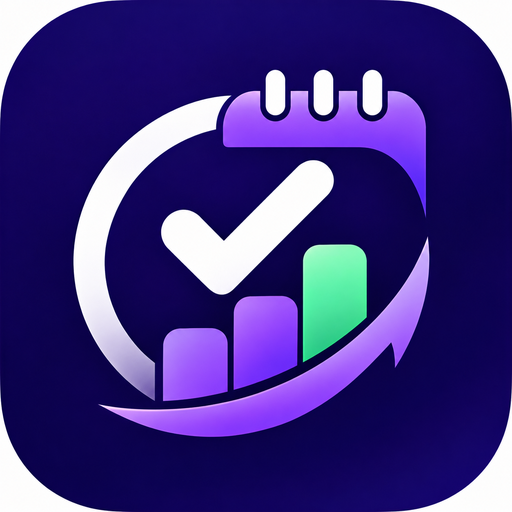

<h1 align="center">Habit Builder Tracker</h1>

  <strong>Build consistency. Track progress. Stay focused.</strong> 
  Offline-first personal productivity app · v1.5.39 · Local Storage Stable

  <a href="https://github.com/aaltafbhat/habit-builder-tracker/releases/tag/v1.5.39">Download v1.5.39</a>
  ·
  <a href="#screenshots">Screenshots</a>
  ·
  <a href="#installation">Installation</a>

Habit Builder Tracker is an offline-first personal productivity application for managing daily habits, tasks, projects, milestones, notes and focused work. It uses a local profile system with a separate IndexedDB database per workspace. Optional profile password protection encrypts workspace records using Web Crypto (PBKDF2 + AES-GCM).
Features
Multiple local profiles: Create, switch, edit and manage separate workspaces.
Daily tracking: Organize daily tasks, habits and priorities.
Discipline Builder: Monitor consistency and personal progress.
Projects and milestones: Manage workstreams, targets and outcomes.
Focus Mode: Run focused sessions and retain session state in workspace backups.
Notes and ideas: Capture and organize personal notes.
Profile protection: Optional profile password protection and encrypted workspace records.
Backup and restore: Export portable backups, validate imports and restore with a pre-restore safety backup.
Offline-capable PWA: App shell and local assets support offline use after installation.
Desktop packaging: Windows Electron installer and existing Capacitor workflows.
Screenshots
<table>
  <tr>
    <td width="50%" valign="top">
      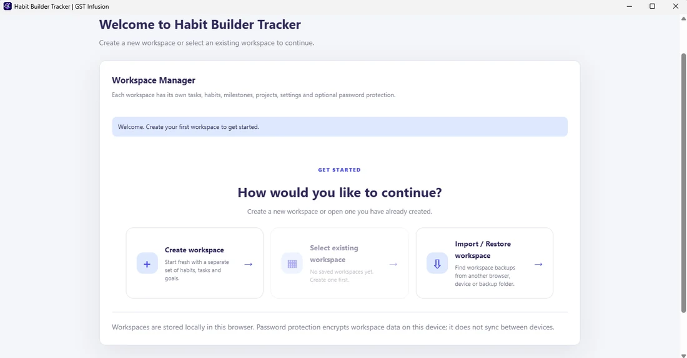
      
<b>Welcome screen</b>

    </td>
    <td width="50%" valign="top">
      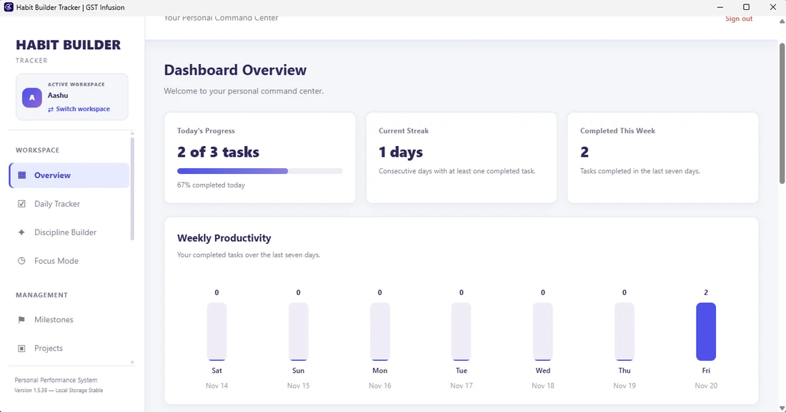
      
<b>Dashboard overview</b>

    </td>
  </tr>
  <tr>
    <td width="50%" valign="top">
      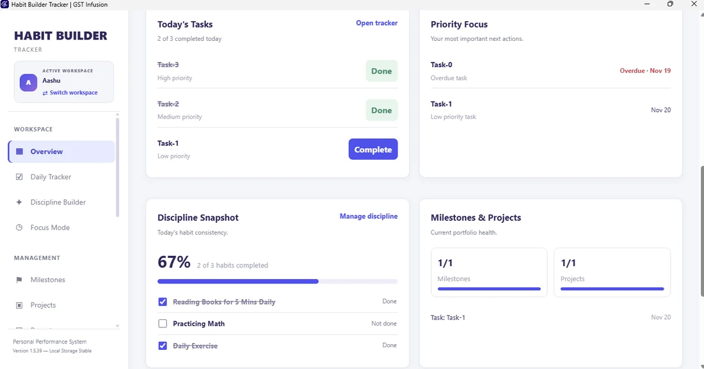
      
<b>Workspace overview</b>

    </td>
    <td width="50%" valign="top">
      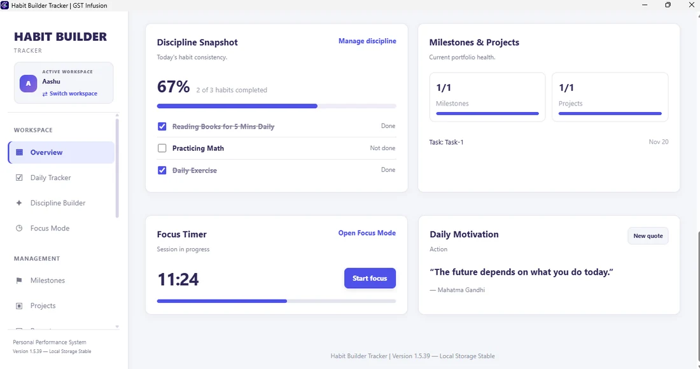
      
<b>Discipline snapshot</b>

    </td>
  </tr>
  <tr>
    <td width="50%" valign="top">
      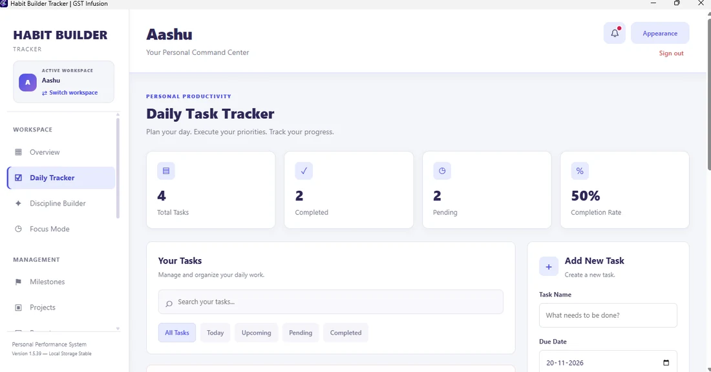
      
<b>Daily tracker</b>

    </td>
    <td width="50%" valign="top">
      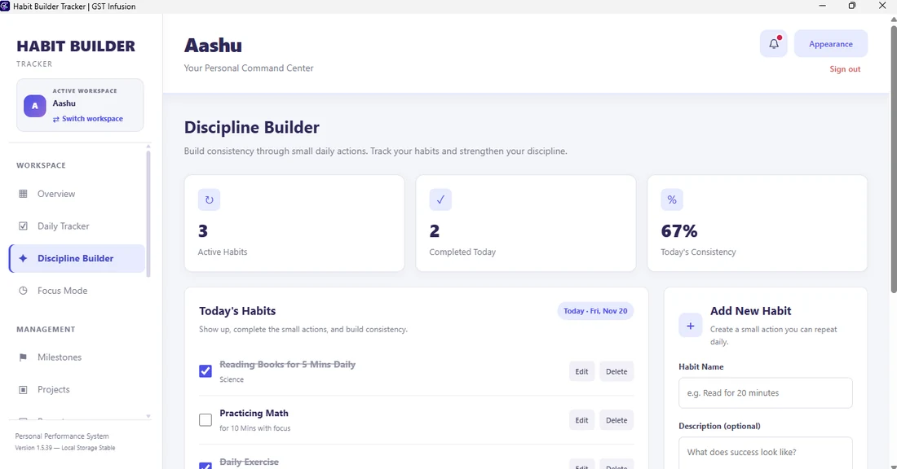
      
<b>Discipline builder</b>

    </td>
  </tr>
  <tr>
    <td width="50%" valign="top">
      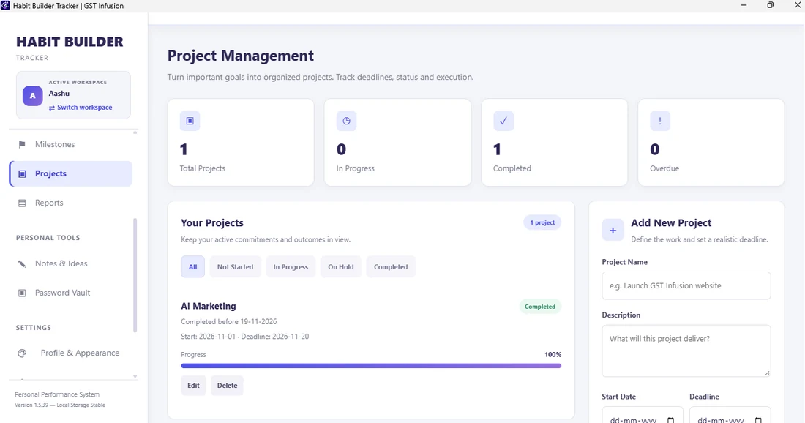
      
<b>Project management</b>

    </td>
    <td width="50%" valign="top">
      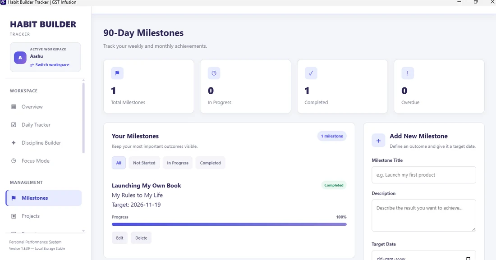
      
<b>Milestones</b>

    </td>
  </tr>
  <tr>
    <td width="50%" valign="top">
      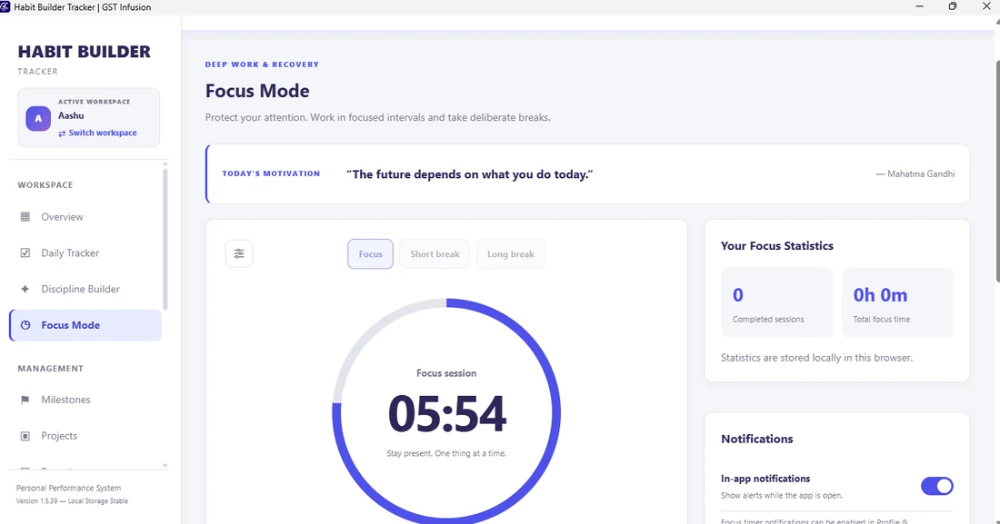
      
<b>Focus mode</b>

    </td>
    <td width="50%" valign="top">
      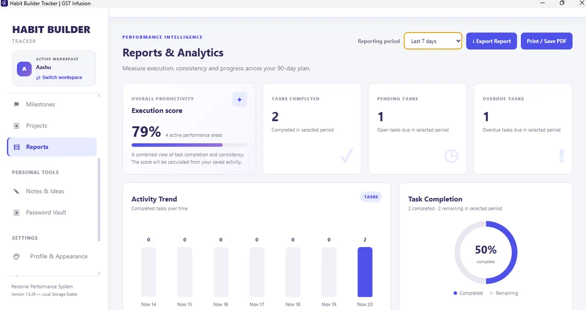
      
<b>Reports and analytics</b>

    </td>
  </tr>
  <tr>
    <td width="50%" valign="top">
      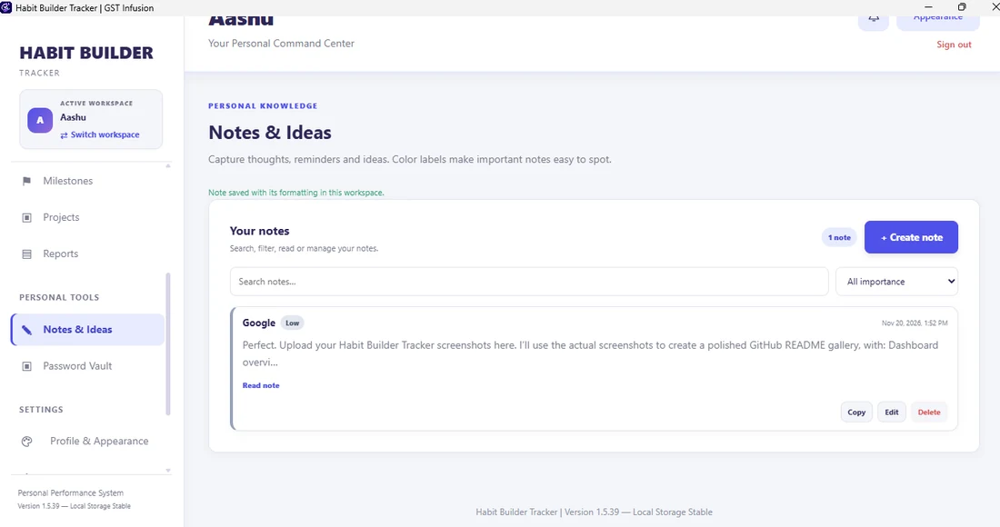
      
<b>Notes and ideas</b>

    </td>
    <td width="50%" valign="top">
      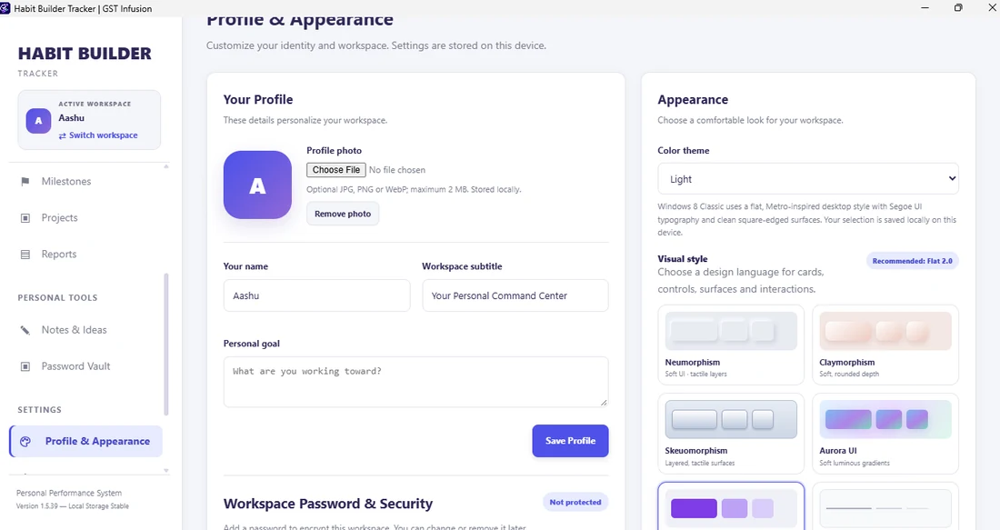
      
<b>Profile and appearance</b>

    </td>
  </tr>
  <tr>
    <td width="50%" valign="top">
      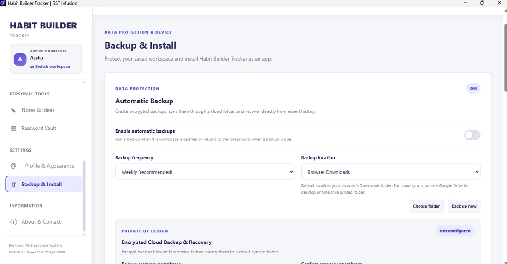
      
<b>Backup and restore</b>

    </td>
    <td width="50%"></td>
  </tr>
</table>
Local-first storage model
Local working data: IndexedDB in the current browser profile or desktop app installation.
Profiles: Managed locally by Workspace Manager; switching profiles opens the matching IndexedDB database.
Encryption: Profile password and encrypted-record flows are retained. Encryption keys remain in memory only while a profile is unlocked.
Backups: Export a portable backup file. Importing a backup as a new profile keeps existing local profiles. Restoring into the active profile replaces its records only after validation and confirmation, with a safety backup first.
Cross-browser/device transfer: Browsers and desktop installations have separate local IndexedDB stores. Move a backup file from the source device and import it on the destination device. Automatic cloud synchronization and shared-folder storage are not included in v1.5.39.
Installation
Windows desktop
Download Habit Builder Tracker Setup 1.5.39.exe from the v1.5.39 GitHub Release.
Run the installer and follow the setup prompts.
Launch Habit Builder Tracker from the Start Menu or desktop shortcut.
Run from source
Install Node.js LTS.
Clone this repository and open its project folder.
Run `npm install`.
Run `npm run desktop:dev` to launch the Electron desktop app.
Run `npm test` to execute the local-storage release checks.
To build a Windows installer from source, run `npm run desktop:win` on a supported Windows build environment.
For the browser/PWA version, serve the project over HTTPS or localhost. IndexedDB data is isolated by browser and origin.
Data safety
Before upgrading, export a backup from each profile that contains data you need. Do not delete browser data, IndexedDB databases, or the app's Electron user-data folder during installation. Keep backup files private, particularly when they contain unencrypted workspace data.
Release
Current stable release: Habit Builder Tracker v1.5.39 — Local Storage Stable
